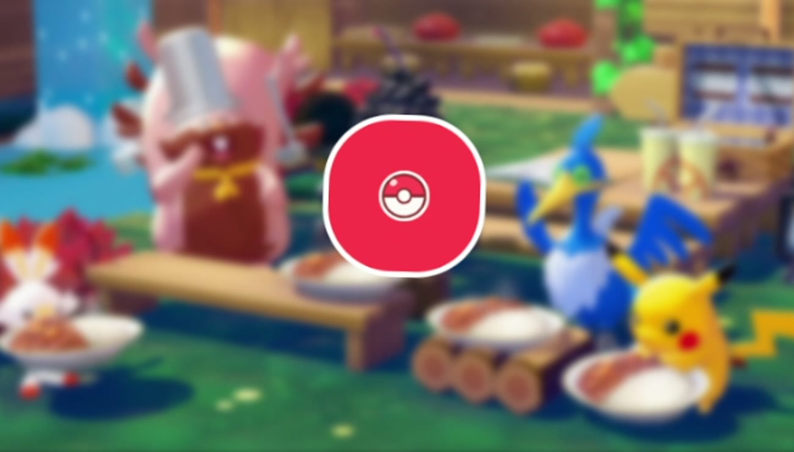
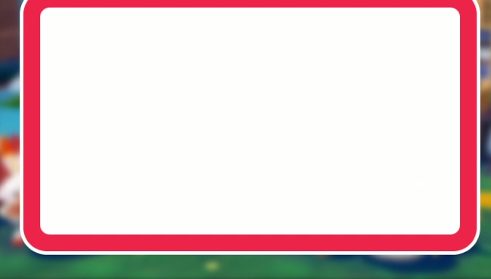
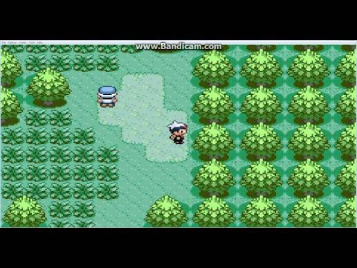

# Motion for Vue 动画对照实验室

项目使用 Vue Router，提供 Quickstart、互动案例和后管页面。Quickstart 按左右两栏对照传统 CSS 与 Motion for Vue，覆盖官网 Vue 入门页中的主要用法；案例页演示精灵球旋转放大并展开面板的转场；后管页面保留原用户管理演示。

## 启动

```bash
pnpm install
pnpm dev
```

## 示例

- **Quickstart：** `/quickstart`，跟随官网 Usage 展示 `<motion />`、animate、initial/exit、手势、whileInView、useScroll、layout/layoutId。
- **案例：** `/cases`，使用提供的游戏图片作模糊背景，点击精灵球后旋转、放大，变成红框白底面板；支持收起和重复播放。
- **后管页面：** `/admin`，原用户管理界面，包含登录、成员管理、菜单抽屉与详情动效。
- **动画示例：** `/examples`，包括 CSS transition 连接状态、Vue `Transition` 进出场、`:nth-child()` 编排、布局重排、hover/press 和滚动联动。
- **状态切换：** CSS transition 连接两个开关状态；Motion 的 `animate` 直接跟随 Vue 状态变化，并可使用弹簧过渡。
- **进出场：** 左侧 CSS transition 配合 Vue `Transition`；右侧使用 `AnimatePresence` 和 `exit` 声明离场目标。
- **子项编排：** CSS 用 `:nth-child()` 逐项设置 animation delay；Motion 用父级 variants + `stagger()` 统一安排子项次序。
- **列表重排：** CSS transition 不知道列表重排前后每张卡片的位置；右侧用 `motion.li` 的 `layout` 属性自动补间布局变化。
- **手势反馈：** CSS 用 `:hover` 和 `:active`；Motion 用 `whileHover` 和 `whilePress` 识别手势，触屏轻点不会误触发 hover。
- **滚动联动：** 左侧用 CSS `animation-timeline: scroll()` 跟随滚动；右侧通过 `useScroll` 获取进度 MotionValue 并绑定到进度条。

两侧共用同一份列表状态，点击顶部的“随机重排”或“反转”即可同时观察。悬停或按压卡片，并在各自的滚动区域滚动，可比较两种动画 API 的写法与反馈。

## 用 Motion for Vue 搭建精灵球转场

案例页的目标是做成一段连续转场：游戏截图先退到背景，红白球旋转并撑开成红色边框，白色内容再从球心接续展开。思路是把画面拆成多个独立图层，再分别交给 Motion 控制。实际代码在 `src/components/pokeball-transition/`。

下面两张关键帧取自用户提供的参考 MP4（约第 2 秒和第 3 秒），用来说明转场的起点与终点；它们是**参考画面**，不是当前页面截图。当前实现将同样的球体到面板思路应用到了 `pokemon-field.jpg` 背景上。

<p align="center">
  
  
</p>

<p align="center"><sub>球体态 → 面板态：两张图分别用于校准主体尺寸、背景虚化、边框比例和展开后的留白。</sub></p>

### 1. 先搭一个舞台

先确定转场发生在哪个矩形区域。舞台负责裁切，背景、遮罩和动画主体各占一层；这样球壳变大时不会撑开页面布局。项目用 `pokemon-field.jpg` 作底图。原图含有黑边和水印，所以不是简单用 `cover` 填充，而是把背景放大并移出舞台边界，再由 `overflow: hidden` 裁掉不需要的部分。



```vue
<div ref="stage" class="transition-stage">
  <motion.img class="scene-background" :src="backgroundImage" alt="游戏场景" />
  <div class="scene-shade" />
  <div class="morph-anchor">
    <!-- 动画主体放在舞台中心 -->
  </div>
</div>
```

```css
.transition-stage { position: relative; isolation: isolate; aspect-ratio: 8 / 5; overflow: hidden; }
.scene-background { position: absolute; top: -28%; left: -2%; width: 104%; height: 150%; object-fit: fill; }
.scene-shade { position: absolute; inset: 0; background: rgb(3 18 9 / 10%); }
.morph-anchor { position: absolute; inset: 0; display: grid; place-items: center; }
```

这里的职责边界是：`.transition-stage` 建立尺寸和裁切边界，`.scene-background` 负责图片裁切与模糊，`.scene-shade` 统一压暗画面，`.morph-anchor` 只负责把转场主体定位在正中。主体使用绝对定位，不参与页面文档流。

背景图和主体分开，后面就可以只模糊背景，不影响球和面板。初始时背景略微模糊，点击后加深模糊：

```vue
<motion.img
  :initial="false"
  :animate="{ filter: expanded ? 'blur(7px)' : 'blur(2px)' }"
  :transition="{ duration: .62 }"
/>
```

### 2. 用一个球壳承担主要形变

不要先放一个球，再突然切换成面板。把它们做成同一个 `motion.div`，同时动画化 `width`、`height`、`borderRadius` 和 `rotate`，视线就会把它理解成同一个物体在变形。

```ts
const shellTarget = computed(() => expanded.value
  ? {
      width: [diameter.value, diameter.value * 1.13, panelWidth.value],
      height: [diameter.value, diameter.value * 1.13, panelHeight.value],
      borderRadius: [diameter.value / 2, diameter.value / 2, 22],
      rotate: [0, -360, -360],
    }
  : {
      width: diameter.value,
      height: diameter.value,
      borderRadius: diameter.value / 2,
      rotate: 0,
    },
)
```

```vue
<motion.div
  class="morph-shell"
  :initial="false"
  :animate="shellTarget"
  :transition="{
    duration,
    ease: 'easeInOut',
    times: [0, .4, 1],
    rotate: { duration, times: [0, .45, 1], ease: 'easeInOut' },
  }"
>
  <!-- 面板和球面符号作为内层图层 -->
</motion.div>
```

关键帧 `[球大小, 稍微弹大, 面板大小]` 让球先有启动感，再铺开；旋转用 `[0, -360, -360]`，并在后段保持角度，避免面板展开完还继续转。`times` 把每个关键帧放到动画进度的指定位置。外壳本身保留红色背景、白色边框和 `overflow: hidden`，所以放大后自然成为面板红框。

| 进度 | 球壳 | 白色面板 | 球面符号 |
| --- | --- | --- | --- |
| `0` | 小圆球 | 隐藏 | 完整显示 |
| `.3` 左右 | 开始旋转和放大 | 仍收起 | 开始缩小 |
| `.4` 左右 | 越过弹性放大点，继续铺开 | 开始显形 | 继续淡出 |
| `.45` 之后 | 接近矩形外框，旋转停止 | 持续长到最终尺寸 | 退出舞台 |
| `1` | 红色圆角面板框 | 白色内容区完整 | 隐藏 |

球壳和符号是两个独立 Motion 节点。父节点的 `rotate` 负责整体旋转；符号节点只处理自己的缩放和透明度，避免图形随着面板拉伸。

```vue
<motion.div
  class="symbol-motion"
  :initial="false"
  :animate="expanded
    ? { scale: [1, .36, .48, 1.05], opacity: [1, 1, 1, 0] }
    : { scale: 1, opacity: 1 }"
  :transition="{ duration: duration * .9, times: [0, .3, .62, 1], ease: 'easeInOut' }"
>
  <PokeballSymbol :expanded="expanded" />
</motion.div>
```

### 3. 让白色内容从球心接上

白底不要和球壳同时直接铺满。它是壳里的第二个 `motion.div`，先保持很小，再逐渐长到扣除边框后的尺寸。通过延后的关键帧，就能做出球先转、白色面板随后展开的层次。

```ts
const surfaceTarget = computed(() => expanded.value
  ? {
      width: [0, 0, diameter.value * .3, panelWidth.value - frameWidth.value * 2],
      height: [0, 0, diameter.value * .22, panelHeight.value - frameWidth.value * 2],
      opacity: [0, 0, 1, 1],
    }
  : { width: 0, height: 0, opacity: 0 },
)
```

```vue
<motion.div
  class="panel-surface"
  :initial="false"
  :animate="surfaceTarget"
  :transition="{ duration, times: [0, .3, .45, 1], ease: 'easeInOut' }"
>
  <!-- 点赞、投币、收藏、关注操作放在这里 -->
</motion.div>
```

球面符号也作为独立内层，不需要手工计算它随外壳变大后的尺寸：外层旋转，符号层在同一时间缩小、淡出即可。这样外壳、白底和球面各自只负责一种视觉变化。

白底和符号都放在绝对定位的内层，使用同一个球心作为原点；父级 `overflow: hidden` 会把它们限制在外壳内部。面板宽高最后减去两侧边框，避免白色内容盖住红色边框。

### 4. 面板展开后，再显示操作按钮

操作按钮在面板出现后淡入并轻微上移；按钮本身用 Motion 手势状态做按压反馈。关注时把前三个按钮设为选中，再依次播放粉色光环和粒子：

```vue
<motion.div
  :initial="false"
  :animate="{ opacity: expanded ? 1 : 0, y: expanded ? 0 : 10 }"
  :transition="{ duration: .24, delay: expanded ? duration : 0 }"
>
  <BilibiliSupportActions :disabled="!expanded || animating" />
</motion.div>
```

```vue
<motion.button
  :whileHover="{ scale: 1.12, y: -3 }"
  :whilePress="{ scale: .9 }"
  :transition="{ type: 'spring', stiffness: 380, damping: 22 }"
>
  <BilibiliActionIcon name="like" />
</motion.button>
```

粒子组件根据角度预先算好每颗粒子的终点，用 `x`、`y`、`scale`、`opacity` 关键帧向外扩散；三组粒子分别加 `0`、`.06`、`.12` 秒延迟，形成连续溅射，而不是同一时刻炸开。

```ts
const particleTarget = {
  x: [0, particle.x * .72, particle.x],
  y: [0, particle.y * .72, particle.y + 12],
  scale: [.2, 1, .6],
  opacity: [0, 1, 0],
}
const particleTransition = {
  duration: particle.duration,
  delay: index * .06,
  times: [0, .35, 1],
  ease: 'easeOut',
}
```

每个粒子的 `x/y` 终点由圆周角度计算，因此方向均匀；`scale` 和透明度让粒子先出现再消散。光环单独扩大并淡出，粒子则带少量下坠，避免所有形状沿直线、同速飞出。

### 5. 让动画适配容器并能安全重播

球的初始直径和展开面板尺寸不能依赖固定视口。案例用 `ResizeObserver` 监听舞台尺寸，再从宽高计算直径、面板和边框；`useReducedMotion()` 开启时直接采用目标状态，并把转场时长缩到极短。点击时先锁定交互，外壳动画完成后再解锁，避免中途重复切换状态。

```ts
const diameter = computed(() => Math.min(124, Math.max(68, bounds.value.width * .18)))
const panelWidth = computed(() => bounds.value.width * .9)
const panelHeight = computed(() => bounds.value.height * .85)
const duration = computed(() => reducedMotion.value ? .01 : expanded.value ? .95 : .5)
```

球直径以舞台宽度的比例计算，同时限制最小值和最大值，保证窄屏上可点击、大屏上又不会显得过大。面板留出舞台边距，边框也按宽度计算。减少动态效果开启时，目标会在极短时间内完成，球面符号和粒子不播放缩放、扩散关键帧。

```ts
function toggle() {
  if (animating.value) return
  animating.value = true
  expanded.value = !expanded.value
}

function complete() {
  animating.value = false
}
```

```vue
<motion.div :animate="shellTarget" @animation-complete="complete">
  <!-- 转场图层 -->
</motion.div>
```

完整实现把状态和目标值放在 `usePokeballMorph.ts`；背景、球符号、操作按钮和粒子各自独立成组件。分层之后，可以单独调整每一段的尺寸、关键帧和时长，而不用把整段转场塞进一个庞大的动画对象。

建议阅读顺序：先看 `PokeballTransitionCase.vue` 的舞台 DOM 层级，再看 `usePokeballMorph.ts` 的状态和动画目标，然后看 `PokeballSymbol.vue` 与 `BilibiliSupportActions.vue`、`BilibiliPinkBurst.vue` 的内容层与庆祝动画。调整节奏时优先改关键帧数组和 `times`；调整构图时改舞台尺寸、球直径比例和面板留白。

## Motion 官方文档

- [Vue Quickstart：motion 组件、状态、手势、滚动和布局](https://motion.dev/docs/vue#usage)
- [Vue animation：状态动画、keyframes、variants 与编排](https://motion.dev/docs/vue-animation)
- [Vue 入门：Motion for Vue 的核心能力](https://motion.dev/docs/vue)
- [AnimatePresence：组件离场动画](https://motion.dev/docs/vue-animate-presence)
- [Layout animation：布局与共享元素动画](https://motion.dev/docs/vue-layout-animations)
- [Gesture animation：hover、press、drag](https://motion.dev/docs/vue-gestures)
- [Scroll animation：滚动触发与滚动联动](https://motion.dev/docs/vue-scroll-animations)
- [useScroll：滚动进度 MotionValue](https://motion.dev/docs/vue-use-scroll)

## 项目命令

- `pnpm dev`：启动 Vite 开发服务器
- `pnpm build`：类型检查并构建生产文件
- `pnpm typecheck`：运行 Vue/TypeScript 类型检查
