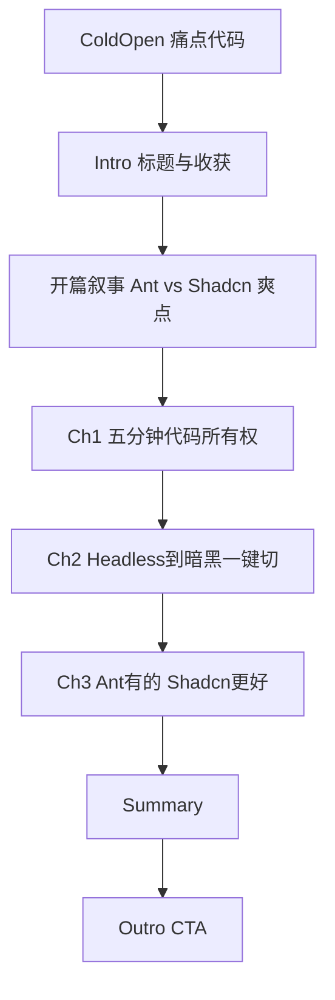

# Scriptoutline

- **完整 Topic 标题**：Vue3+Shadcn：自主掌控！样式「说变就变」
- **系列名**：《前端雨爸》· Vue Tutorial
- **人设/定位**：面向中高级前端，用真实项目痛点对比「黑盒组件库」与「源码在仓 + headless」路线。
- **预估总时长**：约 12～16 分钟（可按剪辑压缩到 10 分钟内）。

**`{topic}` slug（目录名）**：`vue3-shadcn-autonomous-style`（整轮流水线固定使用，勿改名）

---

## 总览表

| 块 | 建议时长 | 一句话目的 |
|----|----------|------------|
| ColdOpen | ~5s | 用 `:deep` / `!important` 痛点代码一瞥，制造「样式战争」共鸣。 |
| Intro | ~8s | 片头标题 + 本期收获：源码所有权、主题一键切、与 TanStack 生态拼接。 |
| 开篇叙事（并入 blog） | — | **Ant Design** 痛点长句 + 「绑架」node_modules vs Shadcn 归还控制权 + **自主掌控爽点**；与 **CodeExample** 紧接，**不再单设**「样式战争」一章。 |
| Chapter 1 | ~3～4min | **五分钟让你拥有代码所有权**：`shadcn-vue` 集成与组件落在 `src/components/ui`。 |
| Chapter 2 | ~4～5min | **Headless哲学到暗黑主题一键切换**：cva + CSS 变量 + `useColorMode`（高潮 1）。 |
| Chapter 3 | ~3～4min | **Ant Design 有的，Shadcn 有更好的**：Table 壳 + TanStack 数据头（Vue 版 API）（高潮 2）。 |
| Summary | ~40s | 三条收束 + 行动点。 |
| Outro | ~25s | CTA：小项目试一遍 + 评论区互动。 |

---

## 分块详述

### ColdOpen

- **口播/字幕要点**：半秒停顿 → 「改个主色，却在和 `!important`、`:deep` 打仗？」→ 切走。
- **情绪**：共鸣、略带无奈，马上转场。
- **画面与模板**（顺序）：
  1. **VideoMedia**（LivingCode）：IDE 中快速滚动到一段「传统覆盖」写法（或最小复刻），鼠标掠过 `:deep` / `!important`。
  2. **CodeExample**：极短 Vue 片段（≤20 行），锚定符号，避免口播念了字观众看不到。
- **录屏成功标准**：能看清选择器层级与「覆盖很丑」的事实，无需读完整个文件。

---

### Intro

- **口播/字幕要点**：本期标题；**看完这个视频，让你抛弃 Ant Design，从新高度出发**；品牌《前端雨爸》。
- **Remotion**：**Intro**；`videoTitle` 与 Topic 标题一致（单行若可读则 string）。

### 开篇叙事（blog 开篇段落，非独立序列块）

- **与 ColdOpen 分工**：ColdOpen 用极短画面 + **CodeExample** 锚符号；**Ant Design 长痛点、node_modules「绑架」、Shadcn 归还控制权、「自主掌控爽点」** 在 `blog.md` 开篇成段口播，**不**再单独做一章 **Signpost**。
- **口播要点（定稿）**：沿用 blog 开篇原文——**Ant Design 项目里** → **每次改按钮色** → `!important` / `:deep(.ant-btn)` → **升级 Ant Design** 仍要重覆盖 → **可复用主题系统几乎不可能**；对比 **传统组件库绑架 node_modules** vs **Shadcn 样式说变就变、主题一键切换**；收束 **「自主掌控才是现代前端爽点」**。

---

### Chapter 1：五分钟让你拥有代码所有权

- **Signpost 成稿**：`集成 shadcn-vue / 组件进仓库`  
  - `line1`：集成 shadcn-vue / `highlight`：组件进仓库 / `line2`：（空）
  - 验算：集成 shadcn-vue = 12，组件进仓库 = 5 → 需检查 **≤30**：12+5=17 ✓
- **口播要点**：不是「又一个 npm 全家桶」；CLI 把 **Button、Card** 等生成到 `src/components/ui/`；Git diff 可见、可 code review。**小结句**：到这里，你已经拥有**代码所有权**的实感。
- **画面与模板**（顺序，与 `Vue3ShadcnAutonomousStyles.tsx` / `segmentFrames` 一致）：
  1. **Signpost**：集成 shadcn-vue / 组件进仓库。
  2. **CodeExample**：**安装命令**——`npx shadcn-vue@latest init` 与 `npx shadcn-vue@latest add button card`（bash）。
  3. **CodeExample**：**`Button.vue` `<script setup>` 节选**（≤20 行）——`defineProps`、`computed` + `cn(buttonVariants)`（与 `app` 内生成物一致）。
  4. **CodeExample**：**`Button.vue` `<template>` 节选**（≤20 行）——原生 `button` + `slot`。
  5. **VideoMedia**：`/ownership` 录屏——目录树 + 预览区 Button/Card（`clip-ownership.webm`）。
- **LivingCode 演示目标**：证明「文件真的在本地」；**成功标准**：资源管理器或编辑器树可见 `components/ui/button` 等。

---

### Chapter 2：Headless哲学到暗黑主题一键切换（高潮 1）

- **Signpost 成稿**：`cva 管变体 / 变量管主题`  
  - `line1`：cva 管变体 / `highlight`：变量管主题 / `line2`：（空）
  - 验算：cva 管变体 = 6，变量管主题 = 5 → 11 ✓
- **口播要点**：Radix Vue（无头）+ Tailwind + **cva**：逻辑与样式解耦；改 `--primary` 等语义 token，`.dark` 下一键反转；`useColorMode` 切 class。**小结句**：你在搭自己的设计系统，而不是「用别人的皮肤」。
- **画面与模板**（顺序）：
  1. **ExcalidrawChart**（叙事型，须带看）  
     - **一图一句结论**：「无头逻辑 + cva 变体 + CSS 变量 = 可维护主题」  
     - **认知路径**：左栏「传统：覆盖 node_modules」→ 右栏「Shadcn：源码 + token」；中间 **Headless + cva + variables** 枢纽向下连到「一键暗黑」。  
     - **带看顺序**：先指左痛点 → 再指枢纽三角 → 最后指「变量 / .dark」收束。  
     - **左右栏题**：「黑盒依赖」vs「源码在仓」  
  2. **CodeExample**：`buttonVariants` 的 cva 节选（≤20 行）。  
  3. **CodeExample**：`:root` / `.dark` 变量节选（≤20 行）。  
  4. **VideoMedia**：点击「切换明暗」按钮，页面与组件同步变（录屏）。  
- **LivingCode 演示目标**：主题切换可见、可重复；**成功标准**：一次点击，整页 token 驱动变化，无 `!important` 堆叠。

---

### Chapter 3：Ant Design 有的，Shadcn 有更好的（高潮 2）

- **Signpost 成稿**：`Ant 有的 / Shadcn 更好`  
  - `line1`：Ant 有的 / `highlight`：Shadcn 更好 / `line2`：（空）
  - 验算：Ant 有的 = 5，Shadcn 更好 = 8 → **合计 13** ✓（「」加在 `highlight`）
- **口播要点**：对比 **Ant Design `Table` 一把梭** vs **Shadcn 提供 UI 壳**（Table 等）+ **@tanstack/vue-table** 管列模型、排序、分页（Vue 3 用 `useVueTable`，**禁止**照抄 React 的 `useReactTable`）。组合优于单体。**小结句**：扩展是生态拼接，不是等厂商发版。
- **画面与模板**（顺序，与 Remotion 表格三段一致，每段 CodeExample ≤20 行）：
  1. **VideoMedia**：表格排序或列头交互（短录屏）。  
  2. **CodeExample（`codeTableSetup`）**：import + `createColumnHelper` + `sorting` / `pagination` 的 `ref`。  
  3. **CodeExample（`codeTableUseVueTableState`）**：`useVueTable` 的 `data` / `columns` / `state`。  
  4. **CodeExample（`codeTableUseVueTableHandlers`）**：`onSortingChange` / `onPaginationChange` + 三个 `get*RowModel`；模板里用 `TableHeader` / `TableRow` 与 row model 绑定（文稿与 blog 另述）。  
- **LivingCode 演示目标**：可见表头 + 至少一行数据 + 一次排序或筛选；**成功标准**：操作与口播同步，无长时间空白。

---

### Summary

- **形式**：**3～4 条** emoji + 小标题 + 一句描述（与 **Summary** 模板 `items` 上限一致）。
- **建议条目**（可微调）：
  1. 代码所有权：组件在仓内，diff 可见。  
  2. 变体与主题：cva + CSS 变量 + 暗黑 class。  
  3. 生态扩展：TanStack Table 与 Shadcn 壳组合。  
  4. 行动：下一行命令 `add button`，改一次就懂。  

---

### Outro

- **口播要点**：从「被组件库绑架」到「自主设计系统」；关注《前端雨爸》；评论区问：你正在用哪套 UI、最想拿 Shadcn 改哪一页？
- **Remotion**：**Outro**；`title` ≤15 字，如「本期回顾」；`ctaText` 固定「订阅关注」。

---

## 附录：章节逻辑流（可选）

