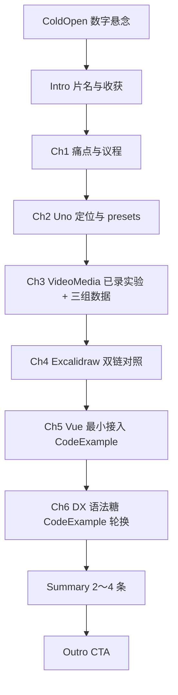

# 脚本大纲元信息

- **完整 Topic 标题**：Vue3+UnoCSS：前端界的速溶咖啡！比 Tailwind 更快的 CSS 引擎
- **系列名**：《前端雨爸》技术短视频（可按实际系列名替换）
- **人设 / 系列定位**：Vue3 + Vite 工程化向原子化 CSS，偏「可验证结论 + 诚实迁移边界」
- **预估总时长**：约 11～14 分钟（可按成片再压缩 ColdOpen 与各章）

> **成片素材说明**：「同页 Admin Dashboard 双实现（Tailwind vs UnoCSS）」对比实验 **已由作者录制完成**，本大纲 **不要求新增 demo 工程开发与 Playwright 录屏**；该段成片统一走 **VideoMedia（既有实验视频）**。Vue 接入与语法糖段落以 **CodeExample**（摘自 `index.md`、每块 ≤20 行）+ 口播为主，不额外规划 LivingCode 新录屏。  
> **画面对齐（与已录成片一致）**：并排对比时 **左侧为 UnoCSS**、**右侧为 Tailwind CSS**；口播与字幕凡出现「左 / 右」均按此执行，数据与 **左→右** 顺序一致时为 **Uno（22KB / 24KB / 9ms）→ Tailwind（48KB / 56KB / 28ms）**。

---

## 总览表

| 块名称 | 建议时长 | 一句话目的 |
|--------|----------|------------|
| ColdOpen | 约 5s | 用「体积 + 毫秒」反差勾起好奇：原子化 CSS 的 dev 侧也能差一截 |
| Intro | 约 8s | 片名 + 本期收获：搞懂 Uno 的定位、看懂一组可复现数据、知道何时别硬迁 |
| Chapter 1 | 约 90～110s | 痛点共鸣：原子化爽，但样式扫描/HMR 可能成新摩擦 |
| Chapter 2 | 约 100～120s | UnoCSS 是什么：Instant / on-demand / atomic + presets 拼装哲学 |
| Chapter 3 | 约 140～170s | **核心**：公平对比口径 + 播放已录实验 + 引用实测数据 |
| Chapter 4 | 约 90～110s | 理论收束：Tailwind 常见链 vs Uno 常见链（短路径叙事） |
| Chapter 5 | 约 100～120s | Vue3 最小接入（vite + uno.config 骨架） |
| Chapter 6 | 约 120～150s | 开发体验加分项：icons / shortcuts / attributify / variant group / inspector（口播密、代码短） |
| Summary | 约 25～35s | 2～4 条带走结论 |
| Outro | 约 15～20s | 收束 + CTA |

---

## 分块详述

### ColdOpen（强烈推荐）

- **时长**：约 5 秒。
- **情绪基调**：好奇、略「反常识」——数字先声夺人。
- **口播 / 字幕要点**（择一或叠化）：
  - 「同样一页后台 Dashboard：首包 CSS **22KB 对 48KB**。」
  - 「热更新链路：**24KB 对 56KB**，时间 **9 毫秒 对 28 毫秒**。」
  - 落一句悬念：「差在哪条构建链路上？」（若画面已并排：**左 Uno、右 Tailwind**，数字从左到右念即 **22→48、24→56、9→28**。）
- **画面与 Remotion**：
  - **VideoMedia**：直接使用 **已录对比实验** 中带终端 / Network / Vite 日志或自定义 HUD 的 **数字特写剪辑**（无新录屏）。
  - 可选叠 **CodeExample**：仅展示一行对比表头类文案（非必须）。
- **数据口径（写入口播 / 字幕小字说明）**：
  - 指标：**首次加载 CSS 体积**、**HMR 更新 CSS 体积**、**HMR 耗时**。
  - 结果（与画面 **左 Uno / 右 Tailwind** 对齐，避免观众猜）：**左侧 UnoCSS** 首包 **22KB**、HMR **24KB**、**9ms**；**右侧 Tailwind** 首包 **48KB**、HMR **56KB**、**28ms**。
  - 强调：同一套页面、同一机器与依赖版本、同一次改动的口径下结论；**不**外推为「所有项目恒成立」。

---

### Intro

- **时长**：约 5～10 秒。
- **口播要点**：
  - 片名完整读出（可与 `index.md` 标题一致）。
  - 本期三件事：搞清 **UnoCSS 官方 slogan 的工程含义** → 用 **一组你已测得的数据** 说话 → 结尾 **迁移边界** 不尬吹。
- **品牌露出**：右下角 **《前端雨爸》**（或与当前频道名一致）。
- **Remotion**：**Intro** 模板。

---

### Chapter 1：痛点与议程

- **Signpost 成稿（≤30 字）**：`拼 class 很爽 / 热更变慢 / 谁背锅`  
  - **分段示意**：`line1`「拼 class 很爽」+ `highlight`「热更变慢」+ `line2`（空）。
  - **字数验算**：全串 18 字（含 `/`），≤30 ✓  
- **口播要点**：
  - 原子化 = 拼乐高：协作与预测性好。
  - 但项目变大后，**开发期**「首编 + HMR」里与 **样式扫描 / 生成** 相关的成本会浮上来。
  - 预告：后面用 **同页双实现** 和 **你片子里那三组数** 对齐体感。
- **画面**：
  - **PictureMedia**（可选）：高质量「乐高 / 拼图」类隐喻图 **仅作点缀**；或直接用 **VideoMedia** 实验画面中「复杂 Dashboard」静帧 1～2 秒。
  - **Signpost** 模板。
- **Remotion 顺序建议**：**Signpost** →（可选）**PictureMedia** 或 **VideoMedia** 静帧。

---

### Chapter 2：UnoCSS 是什么（不是「又一个 Tailwind」复述）

- **Signpost 成稿**：`UnoCSS 不是 / 又一个 Tailwind / `  
  - **分段示意**：`line1`「UnoCSS 不是」+ `highlight`「又一个 Tailwind」+ `line2`（空）。
  - **字数验算**：含空格与符号约 22 字，≤30 ✓  
- **口播要点**：
  - 官方 slogan：**Instant On-demand Atomic CSS Engine** → 翻译：**写到的 class 才生成；生成路径尽量短；可组合**。
  - **presets 拼装**：能力边界清晰，团队按项目裁剪（`preset-uno`、`preset-icons`、`preset-attributify` 等）。
  - 一句诚实垫话：Tailwind 生态成熟；Uno 更偏 **规则引擎 + 预设**，比较维度应是 **工程路径与团队维护成本**，不是站队骂人。
- **画面**：
  - **CodeExample**：官网 slogan 一行 + `uno.config.ts` 里 `presets: [...]` 片段（≤20 行，可从 `index.md` 截取）。
  - **Feature**（可选）：三条 bullet — 按需 / 即时 / 可插拔。
- **例外说明**：本章 **不规划新 VideoMedia 录屏**；若需动感，用 **Intro 级动效** 或 **CodeExample** typewriter。

---

### Chapter 3：可复现实验 + 你的数据（全片主轴）

- **Signpost 成稿**：`同页双实现 / 数据不骗人 / `  
  - **分段示意**：`line1`「同页双实现」+ `highlight`「数据不骗人」+ `line2`（空）。
  - **字数验算**：13 字，≤30 ✓  
- **口播要点**：
  - **控制变量**（与 `index.md` 一致，口播压缩）：同机器、同 Node/Vite、同路由与组件树、除样式栈外依赖对齐；HMR 动作固定（如 `p-4→p-5`、布局 class 批量改等）。
  - **播放你已录制的对比实验 VideoMedia**：先展示「双工程并排（**左 UnoCSS、右 Tailwind**）」或「同指标 HUD」，再口播带出三组数；指屏时说「左边这组数 / 右边这组数」与数据一一对应。
  - **数据重申**（与 ColdOpen 一致，可加一句「这是我们这次跑出来的结果」）：
    - 首次加载 CSS：**22KB vs 48KB**
    - HMR CSS：**24KB vs 56KB**
    - HMR 时间：**9ms vs 28ms**
  - **边界句**：扫描 glob、插件数量、自定义规则过重时，瓶颈会转移——鼓励观众 fork 自己的 README 测法。
- **画面**：
  - **VideoMedia（主）**：**整段或长镜头使用已有对比实验成片**（无需新 demo）。
  - **CodeExample**（辅）：对比表 Markdown 或极简表格（≤20 行），便于 Remotion 上屏与片尾资料卡一致。
- **Remotion**：**Signpost** → **VideoMedia** → **CodeExample**。

---

### Chapter 4：为什么链更短（理论对照，服务上一章数据）

- **Signpost 成稿**：`Tailwind 走 / PostCSS 长链 / Uno 更短`  
  - **分段示意**：`line1`「Tailwind 走」+ `highlight`「PostCSS 长链」+ `line2`「Uno 更短」。
  - **字数验算**：约 22 字，≤30 ✓  
- **口播要点**：
  - Tailwind 常见形态：`@tailwind` + 内容扫描 + PostCSS 插件体系 → **成熟、生态厚、每步有成本**。
  - UnoCSS 常见形态：Vite 插件一体化，**token → 规则命中 → CSS** 叙事上的短路径（与 Chapter 3 数据 **因果呼应**，避免玄学「快 5 倍」）。
- **画面**：
  - **ExcalidrawChart**（推荐，叙事型）  
    1. **一图一句结论**：开发期样式更新，**Uno 常见集成路径更短**，更易得到更小的 HMR 增量与更短耗时（与实测数据呼应，不作绝对化断言）。  
    2. **认知路径**：**左右对比栏** — **左「UnoCSS 典型链」**、**右「Tailwind 典型链」**（与成片 **左 Uno / 右 Tailwind** 一致）；每栏 **自上而下** 步骤流。  
    3. **带看顺序**：先指 **左栏**（Uno）→ **源码变更 → Vite 插件提取 class → preset 规则命中 → 输出 CSS** → 口播点「环节更少、与左边画面数据对齐」；再指 **右栏**（Tailwind）→ **源码变更 → PostCSS / @tailwind → 内容扫描与 utilities 生成 → 插件转换** → 口播点「链路更成熟也更长、与右边画面数据对齐」；最后箭头汇聚到底部 **「HMR 体积 / 时间」标签**，与 Chapter 3 数字 **同屏或口播回扣**（仍按 **左小右大** 读数）。  
    4. **语义密度**：左右 **栏题** 必写清（**左栏题**「UnoCSS：Vite 插件主轴」、**右栏题**「Tailwind：PostCSS 主轴」）；节点用短标签（左栏如「class 提取」「preset 命中」「CSS 输出」；右栏如「内容扫描」「utilities 生成」「插件转换」）。禁止无标题色块堆砌。  
    5. **落盘路径（供 excalidraw-skill）**：`apps/living-projects/vue3-unocss-instant-atomic-css-engine/excalidraw-dev-chain-compare.excalidraw`（文件名可按你习惯微调，与 blog 定稿对齐即可）。
  - **VideoMedia**（可选短切）：若 Excalidraw 与口播已足够，可不重复实验片。

---

### Chapter 5：Vue3 最小接入（工程可复制）

- **Signpost 成稿**：`三行接入 / virtual:uno.css / 就能写`  
  - **分段示意**：`line1`「三行接入」+ `highlight`「virtual:uno.css」+ `line2`「就能写」。
  - **字数验算**：含标点约 24 字，≤30 ✓  
- **口播要点**：
  - `pnpm add -D unocss`（口播可念「包管理器按你团队习惯」）。
  - `vite.config.ts` 里 `UnoCSS()` + `uno.config.ts` 的 `presetUno` / `presetIcons` / `presetAttributify` + `transformerVariantGroup` 一句话交代用途。
  - `main.ts`：`import 'virtual:uno.css'`。
- **画面**：
  - **CodeExample**（主）：分两步 typewriter —（1）`vite.config.ts` 最小片段（2）`uno.config.ts` 核心 presets 片段；每块 ≤20 行，摘自 `index.md`。
  - **例外**：**不新增**操作录屏；若已有旧素材可剪入 **VideoMedia**，非必须。
- **Remotion**：**Signpost** → **CodeExample**。

---

### Chapter 6：开发体验加分项（密而短）

- **Signpost 成稿**：`语法糖五连 / 少写重复 / 好查规则`  
  - **分段示意**：`line1`「语法糖五连」+ `highlight`「少写重复」+ `line2`「好查规则」。
  - **字数验算**：14 字，≤30 ✓  
- **口播要点**（每条 20～30 秒量级）：
  - **preset-icons**：`i-carbon-add` 类写法，少封装 SVG。
  - **shortcuts**：设计系统「团队单词」。
  - **Attributify**：属性分摊密度；提醒团队规范统一。
  - **Variant Groups**：`hover:(...) dark:(...)` 成组。
  - **Inspector**：从「猜」到「看见」规则来源。
- **画面**：
  - **CodeExample** 轮换：`index.md` 中 Demo 1～4 各取 **≤20 行** 上屏；展示顺序：Icons → shortcuts → attributify → variant group；Inspector 可用 **PictureMedia**（官方文档截图，需高清）或 **CodeExample** 一行配置说明。
  - **不规划**新 LivingCode 录屏。
- **Remotion**：**Signpost** → 多个 **CodeExample** 卡段；可选 **Feature** 收束五个关键词。

---

### Summary

- **形式**：**2～4 条**，emoji + 小标题 + 一句描述（与 blog / Remotion Summary 上限对齐）。
- **建议条目**（可微调 emoji）：
  1. ⚡ **短反馈链**：同页实验（**左 Uno / 右 Tailwind**）首包 **22KB vs 48KB**、HMR **24KB vs 56KB**、**9ms vs 28ms**（左为 Uno、右为 Tailwind）。
  2. 🧩 **按需拼装**：presets 裁剪能力边界，升级更可控。
  3. 🛠️ **写得少、查得快**：shortcuts / variant groups / inspector 降重复与排障成本。
  4. ⚖️ **迁移算总账**：深度绑定 Tailwind 插件与 token 时别硬迁，新模块 PoC 更稳。
- **Remotion**：**Summary** 模板。

---

### Outro

- **口播要点**：
  - 收束：UnoCSS 速溶的是 **开发反馈**，不是 **团队规范与生态责任**。
  - CTA：关注 / 三连；评论区欢迎贴你们自己仓库的 **commit + 版本表**；预告下期可讲「preset 选型」或「与组件库混用」。
- **Remotion**：**Outro** 模板。

---

## 附录：整片逻辑流（Mermaid，自检用）

---

## 大纲自检（技能硬约束）

| 自检项 | 状态 |
|--------|------|
| 涉及「对比数据」章节是否 **VideoMedia + CodeExample** 或等价 | **VideoMedia**（已录实验）+ **CodeExample**（数据表）✓ |
| 涉及代码的章节是否有 **CodeExample**（≤20 行/块） | Ch2、Ch5、Ch6 已规划 ✓ |
| 是否误把本应录屏的对比段改成 PictureMedia | 否；对比主轴为 **已有 VideoMedia** ✓ |
| 各章 **Signpost ≤30 字** 且非「本章 + 核心句」 | 已验算 ✓ |
| **ExcalidrawChart** 是否具备结论 / 阅读顺序 / 带看顺序 | Chapter 4 已写 ✓ |
| 并排画面与口播 **左 Uno / 右 Tailwind** 是否全文一致 | 已与成片对齐 ✓ |
